# Screenshot e guida operativa

Le immagini mostrano i principali flussi dell'applicazione Network Topology. Per provare i passaggi, avvia il progetto con `npm start` e apri `http://localhost:4200/`.

I nomi, gli indirizzi IP e gli hostname sono generati automaticamente e possono quindi essere diversi da quelli mostrati. Il file di esempio usato nell'immagine di importazione contiene un solo PC.

## 1. Schermata iniziale

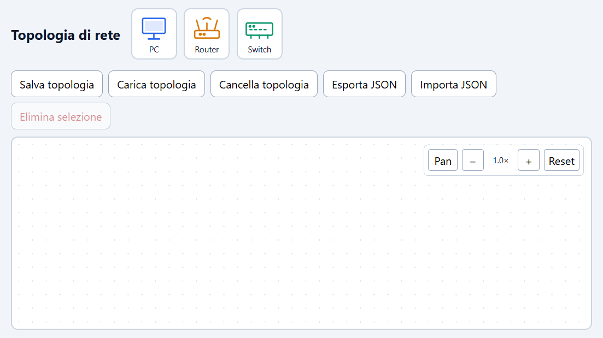

All'avvio trovi la palette con PC, Router e Switch, i comandi per gestire la topologia e il canvas vuoto. I controlli Pan, zoom e Reset si trovano nell'angolo in alto a destra del canvas.

## 2. Inserire i dispositivi

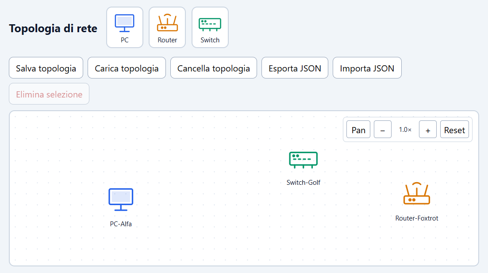

Trascina un elemento della palette nel canvas. Rilascia un PC, uno Switch e un Router nelle posizioni desiderate. L'app crea ogni dispositivo con nome, IP e hostname univoci; per gli Switch assegna anche il numero di porte.

## 3. Collegare i dispositivi

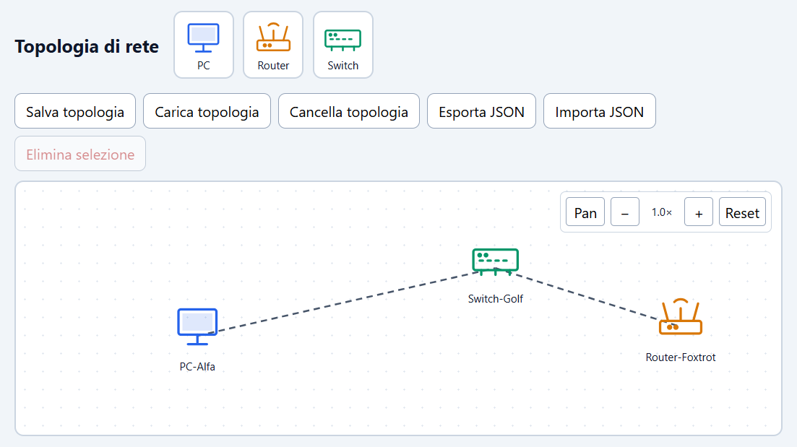

Clicca sul primo dispositivo e poi sul secondo: compare il cavo. Ripeti tra Switch e Router. Per deselezionare senza creare un collegamento, clicca sullo sfondo. Non sono consentiti collegamenti di un dispositivo con sé stesso o cavi duplicati.

## 4. Consultare un dispositivo

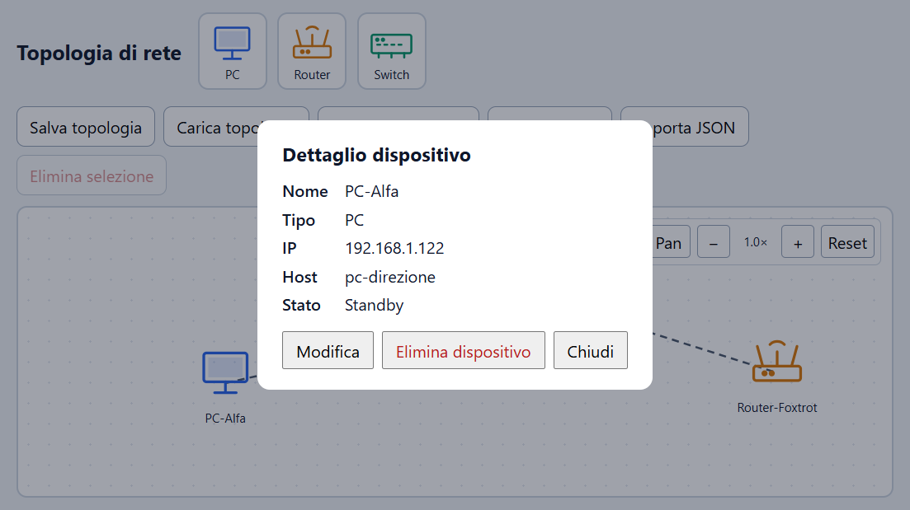

Fai clic con il tasto destro su un dispositivo per aprire il dettaglio. Qui leggi nome, tipo, IP, hostname e stato; per uno Switch sono mostrate anche le porte disponibili.

## 5. Modificare nome e IP

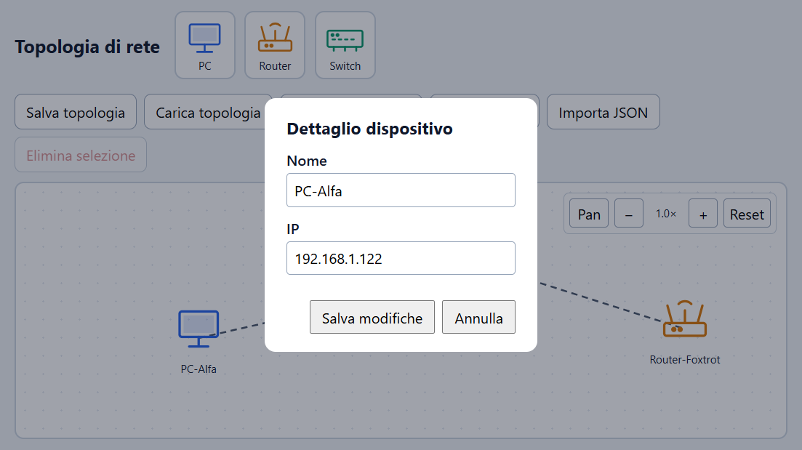

Nel dettaglio seleziona **Modifica**, aggiorna i campi Nome e IP e premi **Salva modifiche**. **Annulla** chiude la modifica senza applicarla. Il sistema rifiuta nomi o IP già assegnati a un altro dispositivo.

## 6. Verificare la modifica

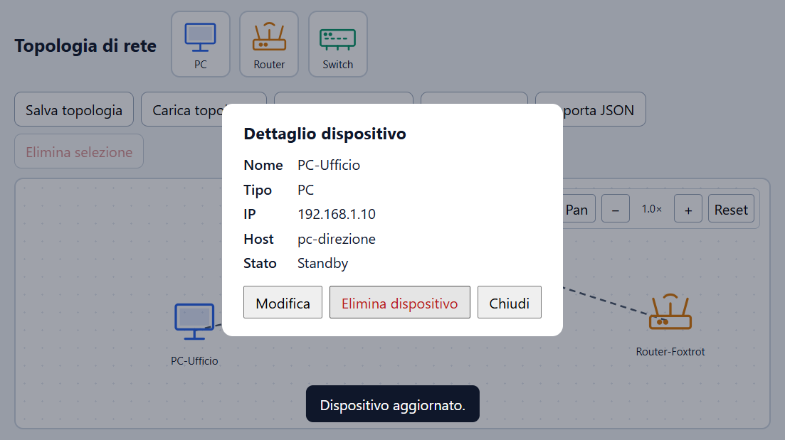

Dopo il salvataggio, il popup mostra i nuovi valori, il nome cambia anche sull'icona nel canvas e appare il messaggio di conferma.

## 7. Consultare una connessione

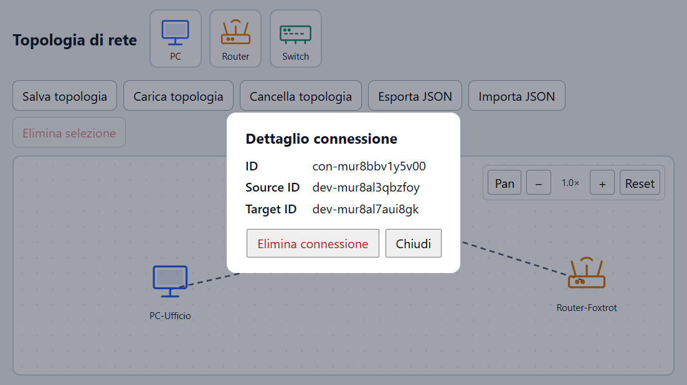

Fai clic destro sul cavo per vedere il suo ID e gli ID dei dispositivi alle due estremità. Dal popup puoi chiudere il dettaglio oppure eliminare la connessione.

## 8. Zoom e spostamento del canvas

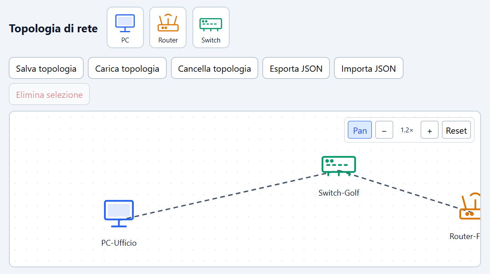

Usa **+** e **−**, oppure la rotella del mouse, per regolare lo zoom. Attiva **Pan** e trascina lo sfondo per spostare la vista. **Reset** riporta zoom e posizione iniziali.

## 9. Salvare nel browser

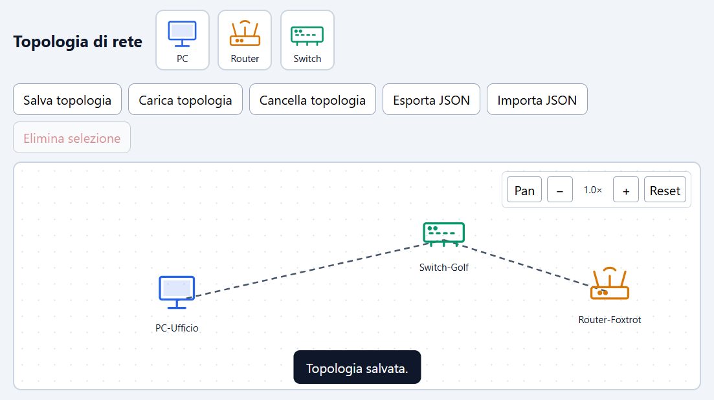

Premi **Salva topologia** per memorizzare nel Local Storage la topologia corrente del browser. Il messaggio conferma l'operazione; i dati non vengono inviati a un server.

## 10. Caricare la topologia salvata

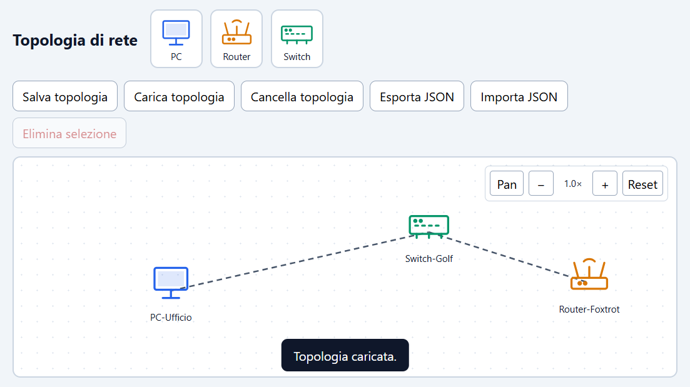

Premi **Carica topologia** per ripristinare i dispositivi e i cavi precedentemente salvati in questo browser. Se non esiste una topologia salvata, non c'è una copia da ripristinare.

## 11. Esportare un file JSON

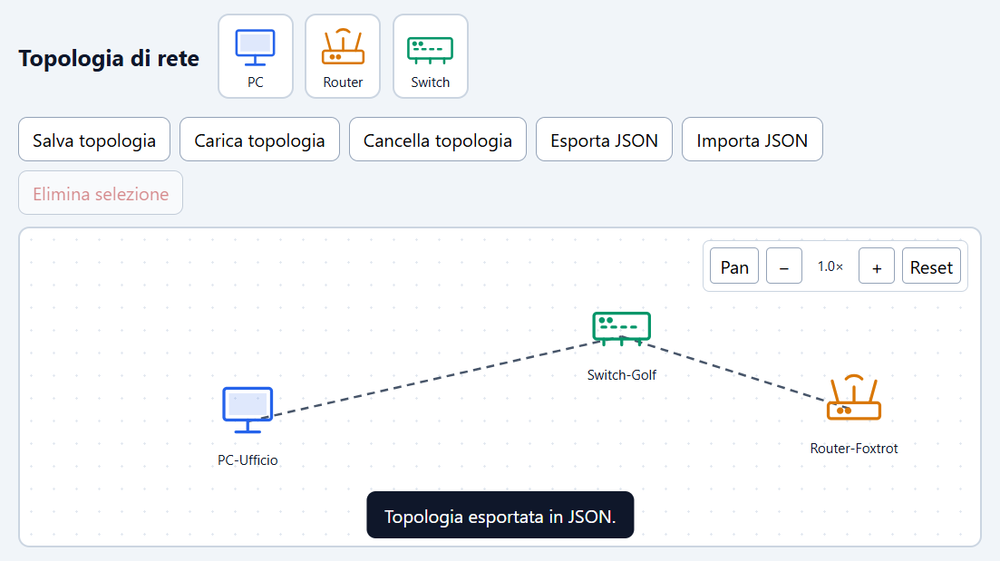

Premi **Esporta JSON** per scaricare un file con i dispositivi, le loro proprietà e le connessioni della topologia corrente. Il messaggio conferma l'esportazione.

## 12. Importare un file JSON

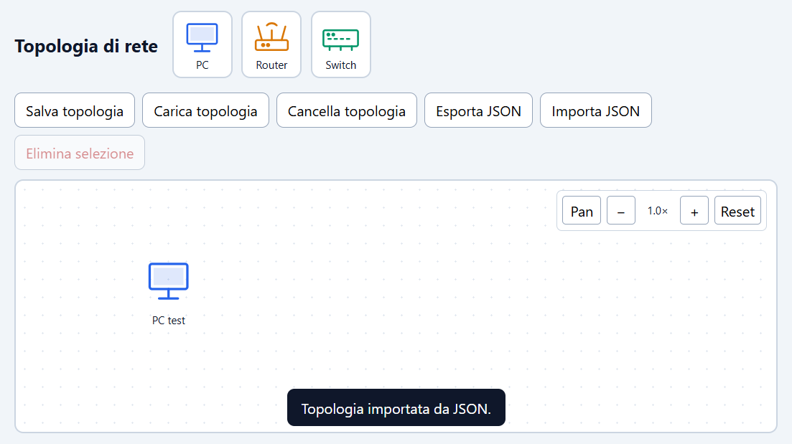

Premi **Importa JSON** e scegli un file valido. Se i dati superano la validazione, la topologia corrente viene sostituita; qui il file di esempio carica il dispositivo `PC test`. Un file non valido non viene importato.

## 13. Selezionare un elemento da eliminare

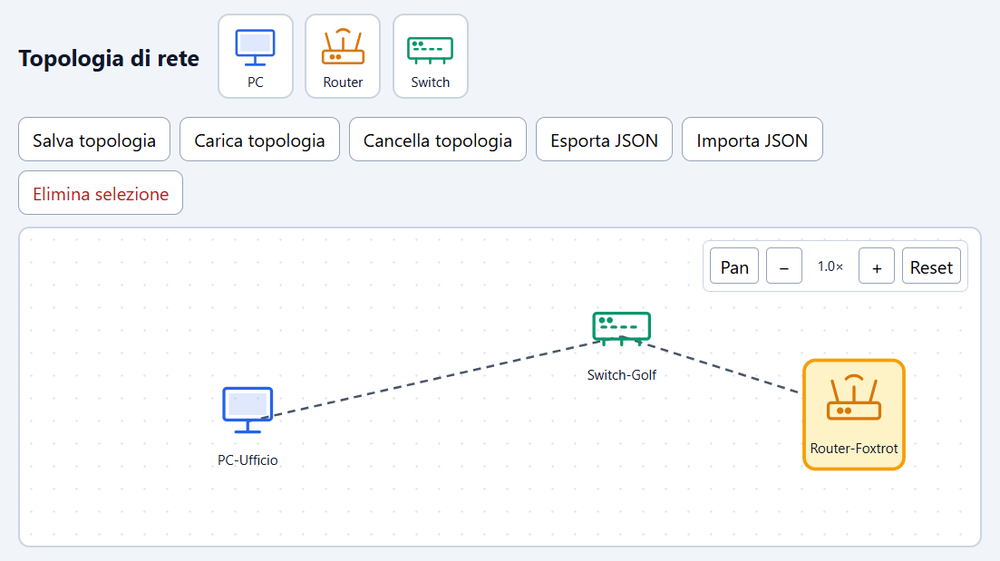

Clicca su un dispositivo o su un cavo per selezionarlo. L'elemento selezionato viene evidenziato e il pulsante **Elimina selezione** si abilita.

## 14. Eliminare un dispositivo

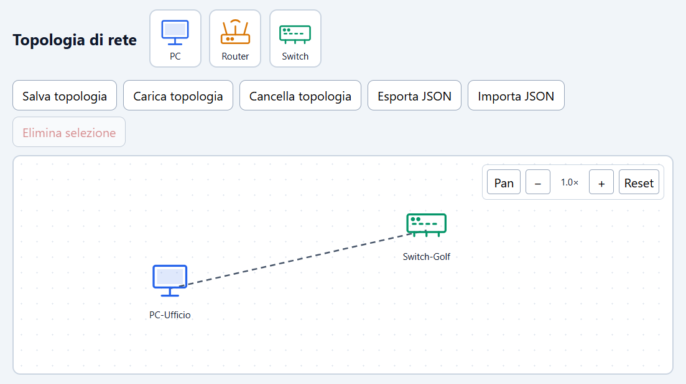

Premi **Elimina selezione** oppure il tasto `Canc`. Eliminando un dispositivo vengono rimosse anche le connessioni collegate a esso; nell'immagine, il Router e il suo cavo sono scomparsi.

## 15. Cancellare la copia salvata

Premi **Cancella topologia** per rimuovere la copia nel Local Storage. Questa azione non svuota il canvas corrente: per eliminare i dispositivi visibili, selezionali e usa **Elimina selezione**.
